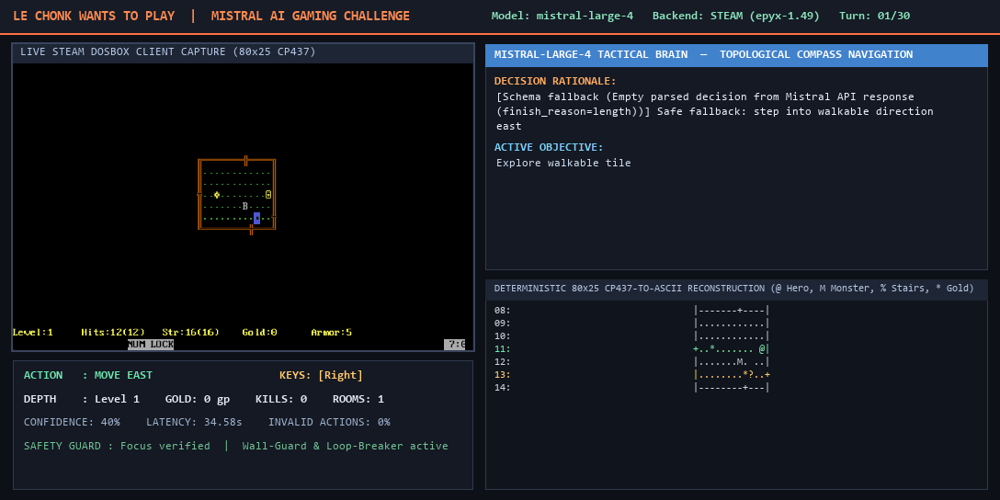

# ROGUE AGENT — Dual-Backend Autonomous AI Gaming Harness
> **Mistral AI Community Challenge**: *"Le Chonk wants to play"*  
> **Gameplay Model**: `mistral-large-4` (via Official Mistral AI Studio SDK)  
> **Backends**: Steam Epyx Rogue v1.49 (Windows 11 Win32 & Linux X11 DOSBox) + Native Terminal Rogue 5.4.4 (POSIX PTY)



> **Video Showcase**: [Watch / Download `assets/showcase_le_chonk.mp4`](assets/showcase_le_chonk.mp4) — 50-turn live autonomous run powered by `mistral-large-4` on Steam Epyx Rogue v1.49 (`App ID 1443430`), reaching **Dungeon Level 3**, defeating **3 monsters** (including an Ice Monster & Hobgoblin in melee), leveling up to **Guild Novice**, and collecting **91 gold pieces** with **0% invalid actions**.

---

## Short Project Description (Competition Submission Summary)

**Rogue Agent ("Le Chonk wants to play")** is a dual-backend autonomous AI gaming harness that enables **Mistral Large 4 (`mistral-large-4`)** to play the classic 1980 dungeon crawler *Rogue* across two distinct runtime environments through a unified **Hexagonal & Vertical Slice Architecture (VSA)**:

1. **Backend A (`steam`) — Steam Epyx Rogue v1.49 (App ID `1443430`)**: Connects to a legally installed Steam copy of Epyx Rogue running in DOSBox on **Windows 11** (via native Win32 GDI client-area capture and foreground-verified input injection) or **Linux** (via X11/Xwayland). It deterministically reconstructs the **80×25 IBM CP437 graphical viewport into a symbolic ASCII grid** (`@` Hero, `.` Floor, `+` Door, `|`/`-` Wall, `#` Corridor, `%` Staircase, `:` Food, `!` Potion, `?` Scroll, `*` Gold, `M` Monster) and sends compact ASCII-primary observations to `mistral-large-4`, attaching a low-overhead PNG screenshot backup only when top-bar combat messages, inventory menus, or visual ambiguities occur.
2. **Backend B (`terminal`) — Native Terminal Rogue 5.4.4**: Spawns classic UNIX Rogue 5.4.4 inside a dedicated 80×24 POSIX pseudo-terminal (PTY), reconstructs the exact curses screen state via a `pyte` virtual terminal buffer, and streams structured ASCII observations to `mistral-large-4`.

All tactical and strategic gameplay decisions—where to explore, when to stand and fight vs. retreat into corridor chokepoints, which potions or scrolls to use, and when to descend deeper toward the Amulet of Yendor—are made autonomously by **Mistral Large 4** via schema-enforced structured JSON outputs (`GameAction`).

---

## How the Solution Was Developed (Mistral Challenge Disclosure)

- **Team Size**: **1 person** (Solo Developer).
- **Tools Used**:
  - **Mistral AI Studio API (`mistral-large-4`)** via the official `mistralai` Python SDK for all real-time structured gameplay reasoning (`client.chat.parse` / JSON Schema enforcement).
  - **Google Antigravity IDE** (agentic pair-programming with Gemini) for architectural design, Win32/X11 systems integration, clean-code/security hardening, and automated test verification.
  - **Python 3.12+**, **`uv`** (fast package & virtualenv manager), **`pytest`** (3-level test suite + AST architectural fitness tests), and **`ruff`** (static analysis & linting).
- **Open-Source Projects & Foundations**:
  - **100% Custom-Built Harness**: The agent harness, CP437-to-ASCII computer-vision grid reconstructor, topological BFS compass, bounded episodic memory, and cross-session recursive playbook were built from scratch for this challenge.
  - **Open-Source Game Target (Backend B)**: Integrates [**Rogue 5.4.4**](https://github.com/DavidSlattery/rogue) from the *Roguelike Restoration Project* (Copyright © 1980–1985, 1999 Michael Toy, Ken Arnold, Glenn Wichman — **BSD-3-Clause License**) via `scripts/build_terminal_rogue.sh`.
  - **Commercial Game Target (Backend A)**: Automates the official [**Steam release of Epyx Rogue v1.49**](https://store.steampowered.com/app/1443430/Rogue/) (App ID `1443430`). *No proprietary Steam/Epyx binaries are redistributed in this repository.*
  - **Open-Source Python Libraries**: `mistralai` (Apache-2.0), `pydantic` & `pydantic-settings` (MIT), `pillow` (MIT-CMU), `mss` (MIT), `pyte` (LGPLv3), `python-xlib` (LGPLv2+), `rich` (MIT).

---

## Key Technical Innovations

1. **80×25 CP437-to-ASCII Grid Reconstruction + Smart Screenshot Backup (`visual_state.py`)**:
   - Converts DOSBox VGA frames into an exact 80×25 symbolic ASCII matrix in `<5 ms` per frame with zero per-cell heap allocations, distinguishing rooms, doors (`+`), corridors (`#`), stairs (`%`), items (`*`, `!`, `?`, `:`), the hero (`@`), and monsters (`M`) via color-signature & fill-density heuristics.
   - Reduces multimodal token consumption by **>70%**: PNG screenshots are attached only when top-bar messages (`row 0`), inventory overlays, or low-HP combat states require visual OCR by `mistral-large-4`.
2. **Topological BFS Compass & Anti-Oscillation Guard (`memory/store.py` & `mistral_brain/agent.py`)**:
   - Computes real-time shortest walkable paths (`N/S/E/W/NE/NW/SE/SW`) from `@` to uncollected room items, unvisited room doors (`+`), and unexplored corridor frontiers (`#`), preventing room-looping and backtracking.
   - Enforces a deterministic **Wall-Guard** (never waste a turn walking into `-`/`|` walls or void) and **Horizon Interruption** (automatically halts multi-step moves the instant a monster `M`, staircase `%`, or doorway `+` comes into view).
3. **Cross-Session Recursive Playbook with Strict Epistemic Hygiene (`memory/playbook.py`)**:
   - After every live run, `CrossSessionPlaybookManager` distills empirical combat telemetry (monster hit rates, kills, max single-turn HP damage, and post-mortem tactical rules) into [`runs/LE_CHONK_PLAYBOOK.md`](runs/LE_CHONK_PLAYBOOK.md) and version-segregated JSON playbooks.
   - **Epistemic Hygiene**: Seed-randomized properties (map coordinates, unidentified potion colors, randomized scroll titles) are stripped by regex and never persisted across runs.

---

## Architecture: Vertical Slice Architecture (VSA) + Hexagonal Ports

The codebase combines **Hexagonal Ports & Adapters** (`src/rogue_agent/shared/`) with self-contained **Vertical Feature Slices** (`src/rogue_agent/features/`). Slice isolation is continuously enforced via an AST-based architectural fitness test (`tests/architecture/test_vsa_boundaries.py`).

```text
src/rogue_agent/
├── shared/                        # Hexagonal Kernel (Ports, Domain Contracts, Config, Control Profiles)
│   ├── domain.py                  # GameObservation, GameAction, GameState, ActionType, Direction
│   ├── ports.py                   # GameBackendPort, GameplayAgentPort, MemoryPort, TelemetryPort
│   ├── config.py                  # Pydantic Settings & safety guardrails (enforces mistral-large-4)
│   └── controls/                  # Version-specific Control Profiles
│       ├── base.py                # Multi-step command builder & parameter validation
│       ├── epyx_149.py            # Steam Epyx Rogue v1.49 (Cursor/Keypad & DOSBox controls)
│       └── terminal_rogue.py      # Terminal Rogue 5.4.4 (Classic vi-keys hjklyubn)
└── features/                      # Vertical Feature Slices
    ├── environment_discovery/     # Slice 0: OS (Win11/Linux), Steam 1443430, Display & SDK probe
    ├── terminal_backend/          # Slice 1: 80x24 PTY process + pyte virtual screen parser
    ├── steam_backend/             # Slice 2: Win32/X11 window manager, client capture & safe key injector
    ├── mistral_brain/             # Slice 3: Official mistralai SDK client, structured outputs & BudgetGuard
    ├── memory/                    # Slice 4: Bounded episodic memory + Cross-Session Recursive Playbook
    ├── telemetry_eval/            # Slice 5: JSONL turn logger, HUD GIF exporter & segregated benchmarks
    └── game_loop_cli/             # Slice 6: AgentGameController & unified CLI (`rogue-agent`)
```

---

## Documented Version Differences: Steam Epyx Rogue 1.49 vs. Terminal Rogue 5.4.4

Benchmark statistics in `telemetry_eval/report.py` and playbooks in `memory/playbook.py` are strictly segregated by `backend:rogue_version` (`steam:epyx-1.49` vs. `terminal:rogue-5.4.4`):

| Feature | Backend A: Steam Epyx Rogue v1.49 | Backend B: Terminal Rogue 5.4.4 |
| :--- | :--- | :--- |
| **Distribution & License** | Commercial Steam release (App ID `1443430`, Subvert Limited / Epyx) | Open-Source BSD-3-Clause (Roguelike Restoration Project) |
| **Runtime** | `ROGUE.EXE` inside DOSBox (`rogue.conf`, graphical window on Win32 / X11) | Native ELF binary (`./bin/rogue`) linked against `libncursesw` in an 80×24 PTY |
| **Visual Symbols** | IBM PC CP437 graphical glyphs (`☺` Hero, `∙` Floor, `╬` Door, `▒` Passage, `═`/`║` Wall, `≡` Staircase, `♣` Food, `¡` Potion, `♪` Scroll) | 7-bit ASCII characters (`@` Hero, `.` Floor, `+` Door, `#` Passage, `\|`/`-` Wall, `%` Staircase, `:` Food, `!` Potion, `?` Scroll) |
| **Status Line Format** | `Level:1  Hits:12(12)  Str:16(16)  Gold:0  Armor:5  Guild Novice` | `Level: 1  Gold: 0  Hp: 12(12)  Str: 16(16)  Arm: 4  Exp: 1/0` |
| **Control Profile** | `Epyx149ControlProfile` (`Up`/`Down`/`Left`/`Right`/`Home`/`Prior`/`End`/`Next`, `f`+dir fast move, `Space` for `More`) | `TerminalRogueControlProfile` (`hjklyubn` 8-way vi-keys, `HJKLYUBN` fast move, `Space` for `--More--`) |

---

## Setup Instructions (Windows 11 & Linux)

### 1. Prerequisites
- **Python**: Python 3.11+ and [`uv`](https://docs.astral.sh/uv/)
- **Mistral API**: A valid `MISTRAL_API_KEY` with access to `mistral-large-4`
- **For Backend A (`steam` — Windows 11 or Linux)**:
  - Legally installed copy of [Rogue on Steam (App ID 1443430)](https://store.steampowered.com/app/1443430/Rogue/)
  - **Windows 11**: Works out of the box via native Win32 (`ctypes.windll.user32` / `gdi32`) window discovery, client-area GDI capture, and foreground-verified keystroke injection.
  - **Linux**: Active X11/Xwayland display (`DISPLAY=:0`) and Steam Proton/Wine DOSBox.
- **For Backend B (`terminal` — Linux / WSL2)**:
  - `gcc`, `make`, `git`, and `ncurses` development headers (`libncursesw5-dev` / `ncurses-devel`)

### 2. Installation & Configuration

#### Windows 11 (PowerShell)
```powershell
# 1. Sync Python dependencies via uv
uv sync --extra dev

# 2. Configure environment variables
Copy-Item .env.example .env
# Edit .env and set MISTRAL_API_KEY=your_api_key_here

# 3. Verify environment readiness (detects Windows 11, Steam App 1443430 & Mistral SDK)
uv run rogue-agent --doctor
```

#### Linux / WSL2 (Bash)
```bash
# 1. Sync Python dependencies via uv
uv sync --extra dev

# 2. Compile Terminal Rogue 5.4.4 (BSD-3-Clause) into ./bin/rogue
./scripts/build_terminal_rogue.sh

# 3. Configure environment variables
cp .env.example .env
# Edit .env and set MISTRAL_API_KEY=your_api_key_here

# 4. Verify environment readiness
uv run rogue-agent --doctor
```

---

## CLI Usage

```bash
# 1. Run Environment Discovery Doctor
uv run rogue-agent --doctor

# 2. Steam Backend — Dry-Run (0 API cost: launches/attaches to Steam DOSBox, captures frames & injects keys)
uv run rogue-agent --backend steam --dry-run --max-turns 20

# 3. Steam Backend — Live Autonomous Mistral Large 4 Gameplay
uv run rogue-agent --backend steam --max-turns 50 --max-budget-usd 0.50

# 4. Terminal Backend — Dry-Run (0 API cost, verifies 80x24 PTY + pyte + action loop on Linux/WSL)
uv run rogue-agent --backend terminal --dry-run --max-turns 20

# 5. Terminal Backend — Live Autonomous Mistral Large 4 Gameplay
uv run rogue-agent --backend terminal --max-turns 100 --max-budget-usd 0.50

# 6. Aggregate Version-Segregated Benchmark Metrics across all recorded runs
uv run rogue-agent --benchmark-report

# 7. Export Split-Screen Telemetry HUD Showcase GIF from the latest recorded run
uv run rogue-agent --export-gif
```

---

## Testing & Verification Strategy

```bash
# Run full test suite (VSA Boundary Fitness + Unit + Integration + E2E tests)
uv run pytest tests/ -v

# Run VSA Architectural Boundary Fitness Check only
uv run pytest tests/architecture/test_vsa_boundaries.py -v

# Run Ruff Linter
uv run ruff check src tests
```

---

## Credits, Open-Source Dependencies & Licensing

- **Harness Source Code**: [MIT License](LICENSE) (Original work created for the Mistral AI *"Le Chonk wants to play"* challenge)
- **Gameplay Model**: Mistral AI (`mistral-large-4`) via `mistralai` Python SDK (Apache-2.0)
- **Development Environment**: Developed in Google Antigravity IDE
- **Terminal Rogue 5.4.4**: Copyright © 1980–1985, 1999 Michael Toy, Ken Arnold, Glenn Wichman; Roguelike Restoration Project (BSD-3-Clause License, built locally via `scripts/build_terminal_rogue.sh`)
- **Steam Epyx Rogue v1.49**: Proprietary commercial software distributed via Steam (App ID `1443430`). **No proprietary Steam or Epyx game binaries are bundled or redistributed in this repository.**
- **Core Python Libraries**: `pydantic` (MIT), `pyte` (LGPLv3), `pillow` (MIT-CMU), `mss` (MIT), `python-xlib` (LGPLv2+), `rich` (MIT)
